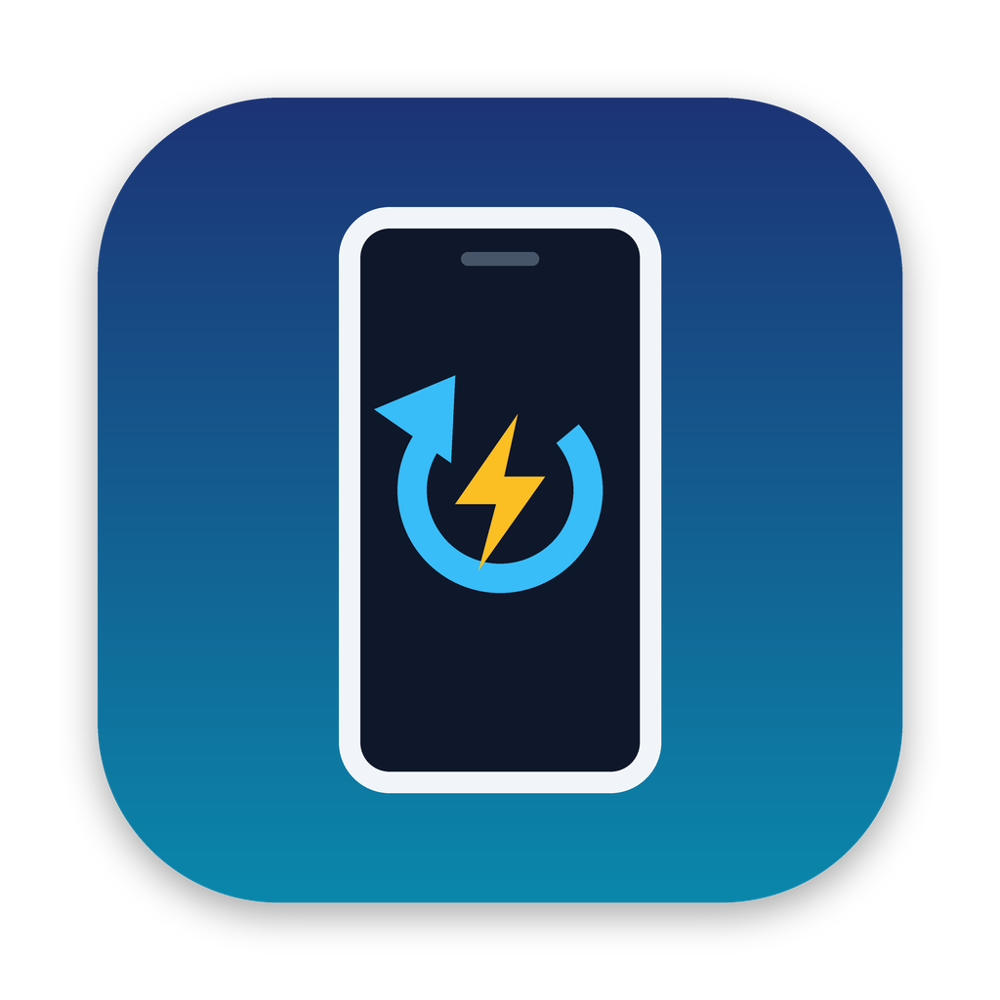

# Xperia Rescue

A macOS app that reinstalls Sony's **official stock Android firmware** on a
bootlooping **Xperia 5 V**: no Windows, no Xperia Companion or Emma needed.



## How it works

Sony doesn't publish fastboot images for its phones, and a locked bootloader
refuses `fastboot flash` anyway. Every modern Xperia, though, has a
**flash mode**: a fastboot-style USB protocol in Sony's boot loader that accepts
Sony-signed firmware **whether the bootloader is locked or unlocked**. It's the
same mode Sony's own repair tools use.

Xperia Rescue drives flash mode with the open-source
[newflasher](https://github.com/munjeni/newflasher), which ships inside the app.
It flashes the firmware package that [XperiFirm](https://xdaforums.com/t/tool-xperifirm-xperia-firmware-downloader-v5-6-1.2834142/)
downloads straight from Sony's update servers. Around that it adds:

- **Live USB detection** of flash mode (`0FCE:B00B`), fastboot (`0FCE:0DDE`) and
  normal Android, since the Xperia 5 V has no notification LED to tell you.
- **Firmware checks** before anything is written: right model (XQ-DE54, XQ-DE72,
  XQ-DE44, SO-53D, SOG12), complete download, enough disk space, whether user
  data can be kept.
- **Read phone & back up TA**: reads the model number, battery and active slot
  in flash mode and saves a trim-area backup, without writing anything.
- **Guided flashing**: newflasher's questions are answered from the options you
  pick (keep data, reboot mode, TA backup), with a progress bar and plain-English
  explanations of errors. The `persist` partition (attestation keys, sensor
  calibration) is never flashed.
- **Fastboot tools**: bootloader info and lock state, switch the active A/B slot,
  reboot modes, flash a single image, erase user data (unlocked bootloaders).
- **ADB tools**: reboot to fastboot or recovery, read phone properties, and save
  a logcat of the bootloop.
- Keeps the Mac awake while flashing and won't quit mid-flash without asking.

adb and fastboot come from Google's official
[platform-tools](https://developer.android.com/tools/releases/platform-tools);
the app downloads them for you (Setup & Tools) or uses a copy you already have
(e.g. `brew install --cask android-platform-tools`). They are optional:
flashing stock firmware only needs the built-in newflasher.

## Get the app

**Pre-built:** every push builds the app on GitHub Actions. Open the latest run
of **Build macOS app** under the repository's *Actions* tab and download the
`XperiaRescue-macOS` artifact (a `.dmg` and a `.zip`). Tagging a commit `v1.0.0`
attaches them to a GitHub release.

**Build it yourself** on a Mac with the Xcode command line tools
(`xcode-select --install`):

```sh
scripts/build-app.sh            # → dist/Xperia Rescue.app, .zip and .dmg
```

The script builds libusb and newflasher from source as universal binaries
(Apple silicon + Intel), builds the Swift app, assembles and ad-hoc signs the
bundle, smoke-tests the bundled newflasher, and packages it.

### First launch (Gatekeeper)

The app is ad-hoc signed, not notarized, so macOS blocks the first launch. Move
it to **Applications**, try to open it once, then go to **System Settings ›
Privacy & Security** and click **Open Anyway**. Or in Terminal:

```sh
xattr -dr com.apple.quarantine "/Applications/Xperia Rescue.app"
```

macOS 13 Ventura or newer is required. No USB driver is needed on a Mac.

## Recovering a bootlooping Xperia 5 V

1. **Find your model number.** It's on the SIM tray label, in Settings › About
   phone, or the app reads it in flash mode (step 4). Japanese carrier models
   SO-53D (docomo) and SOG12 (au) must only get their own firmware.
2. **Download the firmware with XperiFirm.** Get it from its official XDA thread
   (not look-alike download sites). It's a Windows .NET program: run it on a Mac
   with Mono (`brew install mono && mono XperiFirm.exe`), or use any Windows PC
   or VM and copy the folder over. Pick *Xperia 5 V › your model › your region*,
   select the newest build and click **Download**. When this app was written the
   newest build was **67.2.A.3.194** (24 September 2026). Then in the app choose
   **Firmware › Choose…** and select the folder XperiFirm created (named like
   `XQ-DE54_Customized UK_67.2.A.3.194_R3C`).
3. **Put the phone in flash mode.**
   - Unplug it. Hold **Power + Volume Up**: it vibrates once (restart); keep
     holding until it vibrates **three times** and turns off. (If nothing
     happens, hold both for up to 2 minutes.)
   - Hold **Volume Down** and plug the USB cable (already connected to the Mac)
     into the phone. Keep holding until the app shows **Flash mode**. The screen
     stays black.
4. **Read Phone & Back Up TA** (recommended). This confirms the model number
   matches the firmware and stores a trim-area backup in the app's support folder.
5. **Flash Stock ROM.** Try **Keep user data** first. If the phone still
   bootloops afterwards, flash again with it turned off (a full factory reset;
   this fixes most bootloops). Flashing takes about 5–15 minutes; the first boot
   afterwards can take several more.

If anything fails midway, nothing is permanently lost. Put the phone back in
flash mode and flash again; a complete flash repairs a half-written phone.

## Troubleshooting

| Symptom | What to do |
| --- | --- |
| Status never shows *Flash mode* | Phone wasn't fully off, or Volume Down wasn't held while plugging in. Force it off (three vibrations) and retry. Try another cable or port; avoid hubs. |
| `LIBUSB_ERROR_ACCESS` / `BUSY` | Quit other phone tools (Android File Transfer, OpenMTP, Android Studio), replug, retry. Last resort: **Run in Terminal with sudo…** on the Flash page. |
| `LIBUSB_ERROR_IO` / `TIMEOUT` / `NO_DEVICE` | The connection dropped. Use a direct USB-C port and a good cable, then restart from flash mode. |
| "Not enough disk space" | newflasher needs 10 GB free on the disk that holds the firmware folder. |
| "bootdelivery doesn't match" | The firmware is for a different variant. Download firmware for your exact model number. |
| Battery below 15 % | Charge first. The app refuses to flash below 15 % unless you allow it under Advanced. |
| `Command not allowed` in fastboot | The bootloader is locked. Use **Flash Stock ROM** instead; it works while locked. |

## Development

```
Sources/XperiaRescueCore   Foundation-only logic: device catalog, adb/fastboot parsers,
                           firmware inspector, newflasher prompt responder & output analyzer,
                           preflight checks. Builds and tests on Linux too.
Sources/XperiaRescue       SwiftUI app: process runner (pseudo-terminal), IOKit USB monitor,
                           platform-tools installer, views.
Tests/                     XCTest suite for the core (swift test).
scripts/build-app.sh       Builds libusb + newflasher + the app bundle, signs and packages it.
scripts/make_icon.py       Renders Resources/AppIcon.icns (Pillow).
```

```sh
swift test       # core tests (macOS or Linux)
swift run        # run the app unbundled on macOS (no bundled newflasher; see Setup)
```

newflasher asks its questions with `printf` and then blocks in `scanf`, and
whether a question appears depends on the firmware and the phone. Through a
plain pipe its prompts sit in the C stdio buffer and never arrive. The app
therefore runs newflasher under a **pseudo-terminal** (line-buffered output) and
answers each question as it appears (`NewflasherPromptResponder`). Unknown
questions are shown to you instead of being guessed.

## Credits and licences

- [newflasher](https://github.com/munjeni/newflasher) by Munjeni: MIT. Bundled.
- [libusb](https://libusb.info): LGPL-2.1. Bundled as a separate dynamic library
  (`Contents/Frameworks`), built from unmodified source by `scripts/build-app.sh`.
- Android SDK Platform-Tools by Google: downloaded from `dl.google.com` at
  runtime, not redistributed.

Not affiliated with or endorsed by Sony. Xperia is a trademark of Sony Group
Corporation. Flashing firmware is at your own risk; this tool only installs
Sony's own signed firmware and never touches the `persist` partition.
